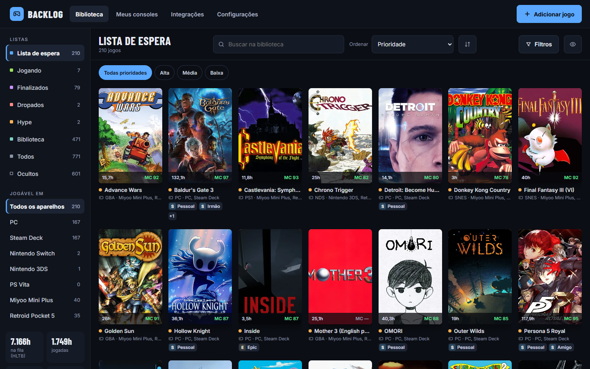
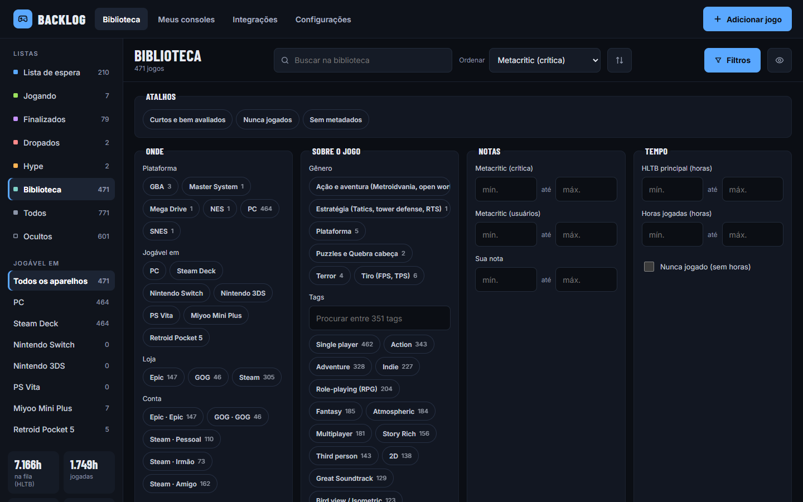
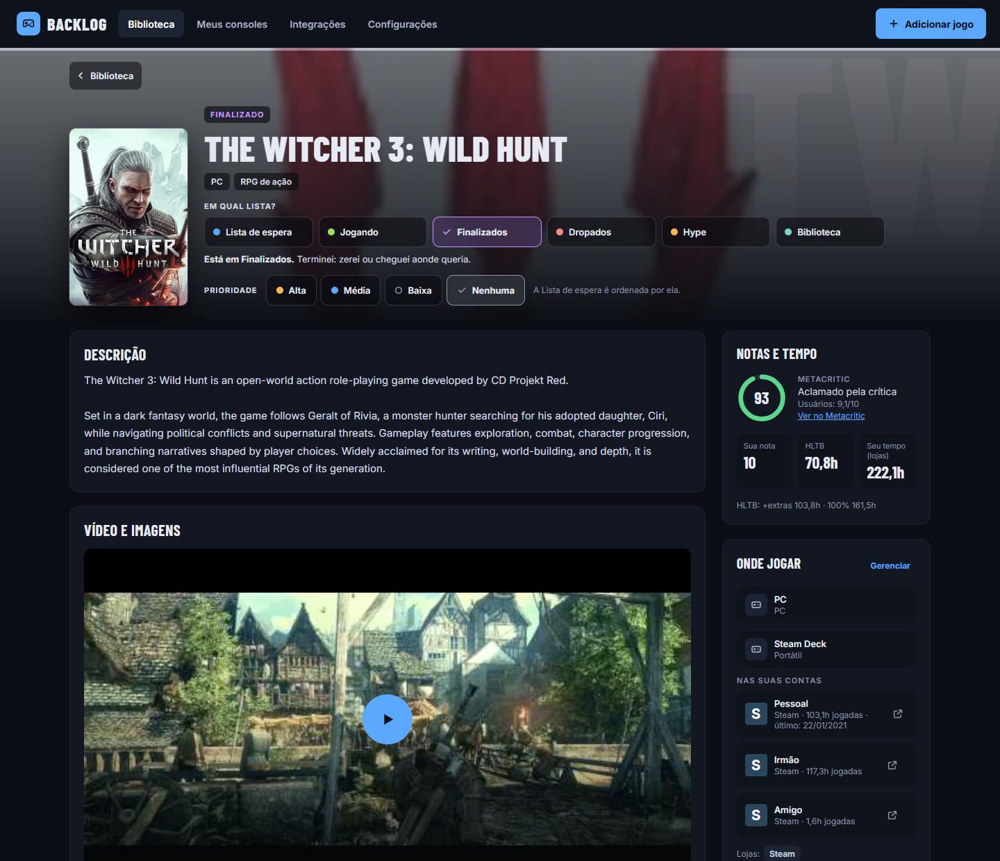
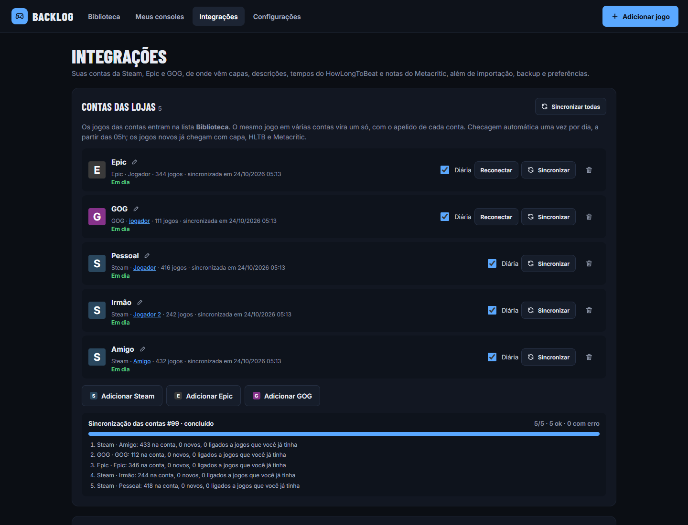
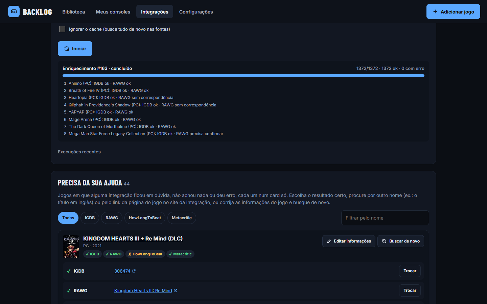
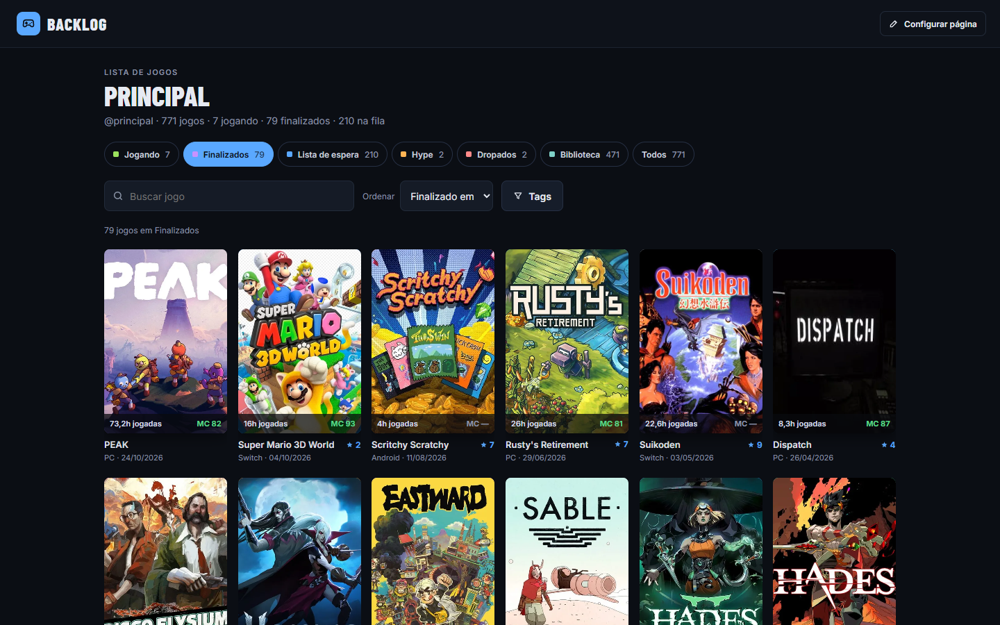
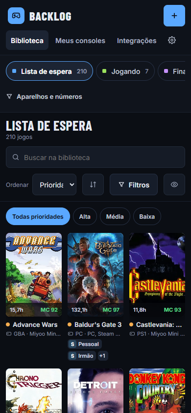
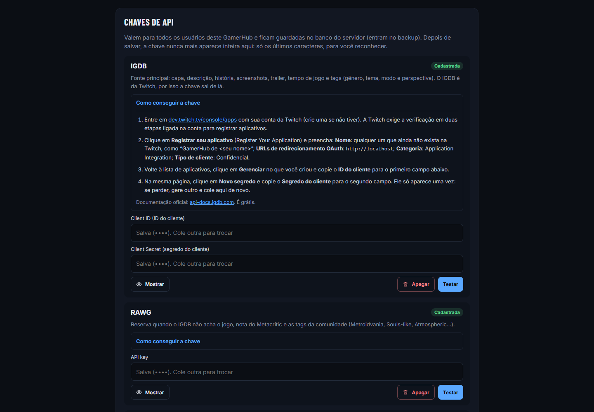

# GamerHub

Backlog de jogos self-hosted. Junta numa página só a lista do que você quer jogar, o que está
jogando e o que já terminou, com as bibliotecas da Steam, Epic e GOG e os dados de cada jogo
(capa, descrição, tempo para zerar, Metacritic), que chegam sozinhos.

Roda num container Docker no seu servidor, NAS ou homelab. Os dados ficam com você.



> Os prints são de uma instância real. Os apelidos das contas e os nomes de perfil foram trocados
> por nomes genéricos.

## Sumário

- [Objetivo](#objetivo)
- [O que ele faz](#o-que-ele-faz)
- [Instalação](#instalação)
- [Como usar](#como-usar)
- [Desenvolvimento](#desenvolvimento)
- [Como o projeto foi criado](#como-o-projeto-foi-criado)
- [Uso de IA (AI disclosure)](#uso-de-ia-ai-disclosure)
- [Uso pessoal e avisos](#uso-pessoal-e-avisos)
- [Licença](#licença)

## Objetivo

O GamerHub nasceu para substituir uma planilha de backlog: abas de "Lista de espera",
"Finalizados" e "Dropados", tempo do HowLongToBeat digitado à mão, nota do Metacritic copiada do
site e uma coluna de lojas. A planilha funcionava, mas tinha problemas:

- **Jogos espalhados:** eles ficavam em várias contas (Steam, Epic, GOG) e em vários aparelhos
  (PC, Steam Deck, Switch, portáteis de emulação), e a planilha não sabia o que já estava em
  cada lugar.
- **Dados à mão:** cada jogo novo pedia que alguém fosse buscar capa, tempo e nota.
- **Respostas difíceis:** era trabalhoso saber, por exemplo, "o que dá para jogar no portátil em
  menos de 10 horas e é bem avaliado".

O objetivo é ter um lugar só, rápido de consultar, que:

1. importe sozinho as bibliotecas das lojas e junte o mesmo jogo de várias contas;
2. busque os metadados (IGDB, RAWG, HowLongToBeat, Metacritic) sem digitação;
3. deixe filtrar e ordenar por aparelho, tempo, nota, tag e status;
4. junte os jogos em listas próprias e mostre quanto de cada uma já foi terminado;
5. guarde suas notas, reviews e anotações de progresso;
6. rode em casa, num container, sem depender de serviço de terceiros para guardar os dados.

## O que ele faz

### Biblioteca e filtros

Status (Lista de espera, Jogando, Finalizados, Dropados, Hype, Biblioteca, Ocultos), filtro por
aparelho na lateral e um painel de filtros com plataforma, loja, conta, gênero, tags, faixas de
Metacritic, tempo do HLTB, horas jogadas e atalhos como "Curtos e bem avaliados". A biblioteca
tem 15 ordenações, entre elas "nota por hora" (Metacritic ÷ HLTB), e aparece em grade de capas ou
em lista, com uma linha por jogo e ordenação clicando no cabeçalho das colunas.

Além do status, cada jogo tem a **posse**: Tenho, Aguardando lançamento, Ainda não comprei ou
Game Pass. As três últimas aparecem como um ícone no card e também servem de filtro. No Hype, o
card mostra a data de lançamento.



### Listas

Listas suas, no estilo do Backloggd ("Metroidvanias", "Para jogar em 2027"), com jogos da
biblioteca ou novos, buscados no IGDB ou na RAWG. Cada lista mostra o progresso pelo status dos
jogos (finalizados, jogando, dropados e quantos faltam) e pode ser ranqueada, com a posição de cada
jogo (#1, #2…) na ordem que você arrastar.

### Página do jogo

Descrição, trailer e screenshots, Metacritic (crítica e usuários), tempos do HowLongToBeat,
horas jogadas por conta, onde dá para jogar, tags, sua nota e review, comentários de progresso e
o resumo da história. Mudar de status, prioridade e posse leva um clique (no Hype, a data de
lançamento fica logo abaixo), e o card **Listas** põe o jogo nas suas listas.

### Adicionar jogos

A busca no IGDB ou na RAWG aceita vários jogos de uma vez. Cada jogo selecionado entra como
**Biblioteca**, com prioridade baixa e posse "Tenho". Dá para trocar isso jogo a jogo ou para todos
de uma vez antes de confirmar. Os dados de todos (capa, HLTB, Metacritic…) são buscados num único
lote.



### Contas das lojas

Várias contas Steam, Epic e GOG, cada uma com um apelido. Os jogos entram no status
**Biblioteca**, o mesmo jogo em contas diferentes vira um só, e uma checagem diária traz os jogos
novos com os metadados.



### Metadados automáticos e "Precisa da sua ajuda"

- **IGDB** é a fonte principal: capa, descrição, história, screenshots, trailer, estúdio e tags
  (gêneros, temas, modos de jogo e perspectiva).
- **RAWG** é o fallback de metadados e também traz a nota do Metacritic e as tags da comunidade
  (Metroidvania, Souls-like, Atmospheric…).
- **HowLongToBeat**, por scraping, dá o tempo para zerar (main, main + extras, 100%).
- **Metacritic**, pelo backend JSON do site, dá o metascore **da sua plataforma**, a nota dos
  usuários e trechos de críticas.

Quando uma integração fica em dúvida, o jogo vai para **Precisa da sua ajuda**, onde você escolhe
o resultado certo, procura por outro nome ou cola o link da página do jogo.



### Página pública e celular

Cada usuário tem uma página só de leitura em `/<usuario>` para mostrar os jogos e as listas
públicas. O app inteiro funciona no celular.

| Página pública | No celular |
|---|---|
|  |  |

## Instalação

O app inteiro roda em **um container**: FastAPI + SQLite servindo o frontend React já compilado.

### Requisitos

- Um servidor, NAS ou PC x86_64 com **Docker** e **Docker Compose**.
- Um disco local para a pasta `data/`. Não use compartilhamento SMB/NFS: o SQLite precisa de
  locks locais.
- Opcional: chaves grátis do IGDB, da RAWG e da Steam (veja [Chaves das integrações](#chaves-das-integrações)).
  Sem elas o app funciona, mas sem capas, descrições e importação da Steam.

### Passo a passo

```bash
git clone <url-deste-repositório> gamerhub
cd gamerhub

cp .env.example .env          # opcional: porta, fuso horário e login
mkdir -p data && sudo chown -R 1000:1000 data
docker compose up -d --build
```

Abra `http://<servidor>:8080`. Na primeira subida as migrações do banco rodam sozinhas e os
catálogos (gêneros, plataformas e aparelhos padrão) são criados.

O `.env` é todo opcional. As opções mais usadas:

| Variável | Padrão | Para quê |
|---|---|---|
| `GAMERHUB_PORT` | `8080` | Porta no host. |
| `GAMERHUB_BIND_IP` | `0.0.0.0` | IP do host onde o app escuta (ex.: só o IP da rede local). |
| `TZ` | `America/Sao_Paulo` | Fuso das datas, dos backups e da checagem diária. |
| `LIBRARY_SYNC_HOUR` | `5` | Hora a partir da qual as contas das lojas são checadas. |
| `AUTH_ENABLED` | `false` | Liga o login e vários usuários. |

A lista completa, com comentários, está em [`.env.example`](.env.example).

Os dados ficam em `./data`:

- `gamerhub.db`: o banco.
- `media/`: capas e screenshots em cache.
- `backups/`: um backup automático por dia, mantendo os 7 últimos.

### Primeiros passos

1. **Configurações → Chaves de API:** cadastre as chaves do IGDB, da RAWG e da Steam. A tela
   explica onde conseguir cada uma e tem um botão para testar.
2. **Integrações → Contas das lojas:** conecte suas contas Steam, Epic e GOG. Também dá para
   [importar uma planilha](#importar-uma-planilha).
3. **Integrações → Enriquecer:** busque os metadados de todos os jogos. Os jogos que chegam pelas
   contas já são enriquecidos sozinhos.



### Segurança na rede

Por padrão o app **não tem login** (veja [Login e vários usuários](#login-e-vários-usuários-opcional)),
então deixe-o acessível só pela rede local ou por VPN (Tailscale, WireGuard). Se for expor, ligue
o login ou ponha um proxy reverso com autenticação na frente.

### Atualizar

```bash
docker compose exec -T gamerhub python -m app.cli backup   # backup antes, por garantia
git pull
docker compose up -d --build
```

As migrações rodam no início do container. O `.env` e a pasta `data/` não são tocados.

## Como usar

### Importar uma planilha

Em **Integrações → Importar planilha** você envia um `.xlsx` ou `.csv`. O assistente mostra uma
prévia, sugere o mapeamento das colunas, deduz o status pelo nome da aba ("Lista de espera",
"Finalizados"…) e simula antes de gravar. Os modos são:

- **novos:** ignora o que já existe.
- **atualizar:** sobrescreve os campos que vierem na planilha e acompanha mudança de status.
- **substituir:** apaga tudo e importa de novo, fazendo um backup antes. As suas listas continuam,
  mas vazias, porque a planilha não tem listas.

Um `export.json` de outro GamerHub entra por **Integrações → Importar → JSON** ou pelo terminal:

```bash
docker compose exec gamerhub python -m app.cli import-json /data/imports/export.json
```

### Chaves das integrações

As chaves são cadastradas em **Configurações → Chaves de API**, que traz o passo a passo de onde
conseguir cada uma e um botão para testar. Valem para o servidor inteiro, então com o login
ligado só administradores veem essa parte. Trocar uma chave vale na hora, sem reiniciar.

| Integração | Precisa de chave? | Onde obter |
|---|---|---|
| IGDB | sim (grátis) | app na Twitch: <https://dev.twitch.tv/console/apps> (Client ID e Client Secret) |
| RAWG | sim (grátis) | <https://rawg.io/apidocs> |
| HowLongToBeat | não | — |
| Metacritic | não (hoje) | o campo só existe para o caso de o site passar a exigir |
| Steam (contas) | sim (grátis) | <https://steamcommunity.com/dev/apikey> (conta Steam com alguma compra) |
| Epic e GOG (contas) | não | login feito pela tela, veja abaixo |

As chaves ficam no banco (e, portanto, no `backup.sqlite` e nos backups diários; não entram no
`export.json`). Quem já tinha `IGDB_CLIENT_ID`, `IGDB_CLIENT_SECRET`, `RAWG_API_KEY`,
`METACRITIC_API_KEY` ou `STEAM_API_KEY` no `.env` não perde nada: no início, cada chave do `.env`
que o banco ainda não tem é copiada para ele uma vez. Depois disso pode tirar as linhas do `.env`.
Uma chave apagada pela tela não volta do `.env`.

### Contas Steam, Epic e GOG

Em **Integrações → Contas das lojas** você conecta quantas contas quiser, cada uma com um apelido.
O apelido aparece no card e na página de cada jogo.

- **Steam:** cole a URL do perfil, nos formatos `https://steamcommunity.com/id/<seu-nome>/` ou
  `https://steamcommunity.com/profiles/<id-de-17-dígitos>/`. Para a lista vir, o perfil precisa
  deixar **"Detalhes do jogo"** como público (Steam → Perfil → Privacidade).
- **Epic:** clique em **Abrir login da Epic**. Com a conta logada, a página mostra um texto com
  `authorizationCode`; cole o texto inteiro (ou só o código). Ele vale poucos minutos.
- **GOG:** clique em **Abrir login da GOG**. Depois de entrar, o navegador para numa página em
  branco; copie a URL dela (tem `code=…`) e cole.

O que acontece com os jogos:

- **Biblioteca:** os jogos das contas entram no status **Biblioteca**, fora da lista de espera.
  É só mudar o status quando quiser jogar.
- **Mesmo jogo em várias contas:** vira **um jogo só**, com os selos de todas as contas. Ele é
  reconhecido pelo mesmo id na loja, pelo mesmo jogo no IGDB ou pelo mesmo nome, e jogos da
  planilha são reaproveitados.
- **Mesclar à mão:** nomes só parecidos ("Witcher 3" e "The Witcher 3 GOTY") viram uma sugestão
  na página do jogo, e também dá para mesclar qualquer jogo com outro.
- **Horas jogadas:** as horas da Steam e da Epic (somadas entre as contas) preenchem o campo
  enquanto você não digitar um valor. A GOG não informa horas.
- **Apagar:** um jogo apagado não volta na próxima sincronização. Na conta, "restaurar
  ignorados" traz de volta.
- **Checagem diária:** a partir das `LIBRARY_SYNC_HOUR` (padrão 5h, no fuso `TZ`), cada conta é
  checada uma vez por dia. Os jogos novos entram e os metadados deles (IGDB, RAWG, HLTB,
  Metacritic e capas) são baixados sozinhos. O botão **Sincronizar** faz isso na hora.
- **Tokens:** Epic e GOG guardam um token de acesso que é renovado a cada checagem. Se o servidor
  ficar semanas desligado, a conta pede para reconectar. Os tokens ficam no banco, ou seja, também
  no `backup.sqlite` e nos backups diários; não entram no `export.json`.

### Enriquecer a biblioteca

Em **Integrações → Enriquecer**, escolha o escopo:

- **sem dados:** jogos nunca enriquecidos.
- **desatualizados:** jogos com dados de mais de 30 dias.
- **todos.**

Cada jogo leva alguns segundos, porque o Metacritic é consultado devagar de propósito (algumas
centenas de jogos levam de 10 a 15 minutos), e as passadas seguintes usam cache. O progresso
aparece na tela, e se o container reiniciar no meio, o job continua de onde parou.

Cada jogo é casado com o item de cada integração por nome, plataforma e ano. Quando uma integração
fica em dúvida (dois "Tomb Raider", por exemplo), não acha nada ou dá erro, o jogo aparece em
**Precisa da sua ajuda**, num card só com todas as integrações dele. Ali você:

- escolhe o resultado certo;
- procura por outro nome em cada integração (ex.: o título em inglês) ou cola o link da página do jogo;
- corrige nome, plataforma ou lançamento e busca de novo ("Mais campos…" abre o editor completo);
- ou ignora aquela integração para o jogo.

Na página do jogo, **Atualizar pela integração** refaz só aquele jogo.

O enriquecimento respeita estas regras:

- Nunca mexe nos seus dados: status, nota, review, tempo jogado, datas, gênero e lojas.
- Valores que você editou à mão (HLTB, Metacritic, descrição, capa) ficam **travados** (cadeado)
  e não são sobrescritos. O cadeado pode ser aberto na página do jogo.
- Resultado vazio de uma integração não apaga o que já existe.

### Tags

Cada jogo junta as tags do IGDB (gêneros, temas, modos de jogo como "Co-operative" e perspectiva
como "First person") com até 12 tags da comunidade da RAWG, sem o ruído de loja (conquistas,
nuvem, suporte a controle). A mesma tag com grafias diferentes entra uma vez só ("Single player" e
"Singleplayer"). Elas ficam em inglês, como vêm das fontes.

As tags aparecem em **Informações**, na página do jogo; clicar numa abre a biblioteca filtrada por
ela, e o filtro também fica em **Filtros → Sobre o jogo**. Em **Editar** dá para tirar e pôr tags; a
partir daí a integração não mexe mais nelas até você destravar. Para trazer as tags novas para uma
biblioteca já enriquecida, rode **Buscar dados → Todos** marcando "Ignorar o cache".

### Listas

Em **Listas** (no menu) você cria uma lista com nome, descrição e duas opções:

- **Ranqueada:** cada jogo mostra a posição na lista (#1, #2…), como num ranking.
- **Pública:** a lista aparece na sua [página pública](#página-pública). Vem ligada.

Para pôr jogos, use **Adicionar jogos** na lista ou o card **Listas** na página de cada jogo. A busca
mostra primeiro os jogos da sua biblioteca. O que não estiver nela vem do IGDB ou da RAWG (precisa da
chave): você escolhe a plataforma e o status, e o jogo entra na biblioteca, com os metadados, e na
lista.

- **Progresso:** vem do status de cada jogo. A barra separa finalizados, jogando e dropados, e mostra
  quantos faltam e as horas do HLTB que ainda faltam. Mudar o status de um jogo atualiza todas as
  listas em que ele está.
- **Ordem:** em **Organizar**, arraste as linhas ou use as setas (no celular). Fora desse modo dá para
  ver a lista por nome, nota, Metacritic e as outras ordenações da biblioteca sem mexer na ordem dela.
- **Grade ou lista:** a mesma escolha da biblioteca (capas ou linhas) vale para as listas.
- **Jogos ocultos:** continuam na lista, apagados e com o selo "Oculto". Na página pública eles não
  aparecem.
- **Apagar ou mesclar:** um jogo apagado sai de todas as listas. Na mesclagem, o jogo que fica herda
  o lugar do outro.

### Backup e exportação

Em **Integrações → Exportar** estão:

- `export.json`: o backup completo, com as listas, reimportável no modo "substituir".
- `export.csv`: no formato da planilha (`;`, abre direto no Excel).
- `backup.sqlite`: cópia do banco.

Para restaurar um `backup.sqlite`, pare o container, substitua `data/gamerhub.db` e suba de novo.

### Login e vários usuários (opcional)

Por padrão o app é de uma pessoa só e abre direto, sem login. Para ligar o login, coloque no `.env`:

```env
AUTH_ENABLED=true
AUTH_ALLOW_SIGNUP=true   # false fecha o cadastro; aí só um administrador cria contas
```

- **Primeiro acesso:** a primeira conta criada vira administradora e fica com a biblioteca que já existia.
- **Biblioteca de cada um:** jogos, notas, comentários, aparelhos e contas de loja são de cada usuário.
  Plataformas, gêneros e etiquetas de loja são compartilhados.
- **Administrador:** em **Usuários** (menu da conta), cria contas, redefine senhas, dá ou tira admin
  e remove usuários junto com a biblioteca deles.
- **Desligar de novo:** com `AUTH_ENABLED=false`, o app volta a abrir direto com a biblioteca da
  primeira conta.
- **Sessão:** o cookie dura `AUTH_SESSION_DAYS` (30 dias) e renova com o uso. Se servir por HTTPS,
  ligue `AUTH_COOKIE_SECURE=true`.
- **`backup.sqlite`:** com o login ligado, só administradores baixam. Ele contém os dados de todos,
  os hashes de senha, os tokens das lojas e as chaves de API.

### Página pública

Cada usuário tem uma página só de leitura em `http://<servidor>/<usuario>`, aberta para qualquer
um, mesmo com o login ligado. Ela mostra os cards dos jogos (capa, status, plataforma, nota,
Metacritic, horas e tags) com abas por status, busca e filtro por tag, e as suas listas públicas,
cada uma com o progresso e a própria página. Jogos ocultos nunca aparecem, e comentários, contas de
loja e aparelhos ficam de fora.

Em **Configurações** cada um troca o nome de usuário (que é o endereço da página), o nome de
exibição e liga ou desliga a página. Ela vem ligada; desligada, o endereço responde "página não
encontrada". Nomes que já são caminhos do app (`biblioteca`, `jogos`, `listas`, `api`…) não podem
ser usados. Com o login desligado, o único usuário se chama `principal` até você trocar.

## Desenvolvimento

Requisitos: Python 3.12+ com [uv](https://docs.astral.sh/uv/) e Node 22.22+ (ou 24).

```bash
# backend (http://127.0.0.1:8000, usa ./data na raiz do repositório)
cd backend
uv sync
uv run uvicorn app.main:app --reload

# frontend (http://localhost:5173, com proxy de /api e /media para o backend)
cd frontend
npm install
npm run dev
```

O dia a dia no backend gira em torno destes comandos:

```bash
uv run pytest                    # suíte completa, sem rede
uv run pytest -m live            # bate em HLTB/Metacritic (e IGDB/RAWG se houver chaves) de verdade
uv run python -m app.cli --help  # import-json, enrich, backup, gc-media, record-fixtures
uv run alembic revision --autogenerate -m "..."   # nova migração depois de mudar os modelos
```

No frontend: `npm test` (vitest), `npm run typecheck` e `npm run build`.

Os testes usam uma biblioteca fictícia de 16 jogos em `backend/tests/fixtures/biblioteca.json` e
respostas gravadas das integrações em `backend/tests/fixtures/`.

### Quando uma integração quebrar

HLTB e Metacritic não têm API oficial e mudam de tempos em tempos. Quando acontecer:

1. Rode `uv run pytest -m live` para ver qual quebrou.
2. **HLTB:** atualize a biblioteca (`uv lock --upgrade-package howlongtobeatpy`) e reconstrua a imagem.
3. **Metacritic:** o provider (`backend/app/integrations/metacritic.py`) tenta o backend JSON,
   depois o JSON-LD da página e, por fim, a nota que a RAWG conhece. Ajuste os endpoints ali.

Enquanto isso o app continua funcionando, e dá para editar HLTB e Metacritic à mão.

### Estrutura

```
backend/app/
  api/            rotas REST (games, lists, catalog, integrations, io)
  models/         SQLAlchemy (games, lists, platforms, devices, links, jobs, cache…)
  services/       importação (JSON/planilha), exportação, backup, cache de imagens
  integrations/   igdb, rawg, hltb, metacritic + matching (rapidfuzz), cache e HTTP com rate limit
  enrichment/     orquestrador (merge) e fila de jobs asyncio persistida
frontend/src/     React + TanStack Query; features/ espelha as telas do protótipo
docs/prototype/   protótipo de design original (especificação visual)
docs/screenshots/ prints usados neste README
```

## Como o projeto foi criado

O GamerHub foi feito em outubro de 2026, em dois dias, como projeto pessoal para aposentar a
planilha de backlog.

1. **Protótipo visual.** Antes do código veio o design: um protótipo navegável ("Portal de
   Backlog"), feito com ajuda de IA, com as telas de biblioteca, detalhe do jogo, adicionar
   jogo, aparelhos e integrações. Ele está em [`docs/prototype/Main.dc.html`](docs/prototype/Main.dc.html)
   e serve de especificação visual: cores, tipografia (Barlow Condensed + Inter) e layout saem dali.
2. **Decisões de produto.** O autor definiu o escopo e as escolhas principais: um container só,
   para rodar em casa; SQLite em vez de um banco separado; login opcional e desligado por padrão;
   IGDB como fonte principal e RAWG como reserva; HLTB e Metacritic por scraping dentro do backend;
   várias contas por loja, com o mesmo jogo virando um só.
3. **Primeira versão.** Biblioteca, detalhe, adicionar jogo, aparelhos, integrações com matching e
   fila de enriquecimento persistida, importação da planilha, exportação e backup diário.
4. **Iterações.** A cada rodada o app era usado de verdade num homelab, e o que incomodava virava a
   próxima tarefa: multiusuário opcional; contas Steam, Epic e GOG com checagem diária e mesclagem;
   filtros ricos e 15 ordenações; "Precisa da sua ajuda" por jogo; jogos ocultos; busca pelo link
   da página do jogo; chaves de API na tela de Configurações; página pública e tags; listas no
   estilo do Backloggd e a biblioteca em lista.

A pilha escolhida:

| Parte | Tecnologia |
|---|---|
| Backend | Python 3.13, FastAPI, SQLAlchemy 2, Alembic, httpx, rapidfuzz, uv |
| Banco | SQLite em modo WAL, com backup diário pela API de backup do SQLite |
| Fila | asyncio dentro do próprio processo, com os jobs salvos no banco (retoma após restart) |
| Frontend | React 19, TypeScript, Vite, React Router, TanStack Query |
| Entrega | Dockerfile multi-stage (Node compila o frontend, Python serve tudo) e Docker Compose |

## Uso de IA (AI disclosure)

Este projeto foi construído com ajuda intensa de inteligência artificial, e é importante deixar
isso claro.

- **Quem escreveu o código.** A maior parte do código, dos testes, das migrações e desta
  documentação foi gerada por IA, com um agente de programação. O protótipo visual também foi
  feito com IA.
- **O que foi humano.** A ideia, os requisitos, as decisões de produto e de arquitetura, a revisão
  das mudanças, os testes de uso no dia a dia, o deploy e a escolha do que entrava em cada versão.
- **Como foi verificado.** Cada mudança passou pela suíte automatizada (pytest no backend, vitest
  e checagem de tipos no frontend) e por uso real numa instância em casa, com uma biblioteca de
  mais de mil jogos. Isso reduz, mas não elimina, a chance de erro.
- **O que isso significa para você.** Código gerado por IA pode ter bugs, casos não previstos ou
  falhas de segurança que passaram despercebidos. Leia o código antes de confiar nele para algo
  importante, e mantenha os backups ligados.
- **O app não usa IA.** Em execução, o GamerHub não chama nenhum serviço de IA e não envia seus
  dados para modelos de linguagem. Ele só conversa com as integrações listadas acima (IGDB, RAWG,
  HowLongToBeat, Metacritic, Steam, Epic e GOG).

## Uso pessoal e avisos

O GamerHub é um projeto **pessoal e sem fins lucrativos**, feito para uso próprio num servidor
doméstico e compartilhado como está.

- **Sem garantia nem suporte.** Não há compromisso com novas versões, correções ou suporte.
  Use por sua conta e risco (veja a [licença](#licença)).
- **Sem vínculo com as marcas.** O projeto não tem relação com Valve/Steam, Epic Games, GOG,
  CD PROJEKT, Twitch/IGDB, RAWG, HowLongToBeat, Metacritic ou Fandom. Nomes, logos, capas e
  descrições pertencem aos donos.
- **Termos de uso dos serviços.** HowLongToBeat e Metacritic não têm API pública: os dados vêm
  das páginas e dos endpoints internos dos sites, em volume baixo e com limite de requisições.
  O login da Epic e da GOG usa os mesmos fluxos públicos de clientes como Legendary e Heroic, que
  não são oficiais. Esses caminhos podem parar de funcionar a qualquer momento, e cabe a quem
  instala respeitar os termos de cada serviço. As chaves do IGDB, da RAWG e da Steam são pessoais
  e seguem os termos de cada API (o plano grátis da RAWG, por exemplo, é para uso pessoal).
- **Conteúdo de terceiros.** Capas, screenshots, descrições e críticas são guardadas em cache só
  para exibição na sua instância. Pense nisso antes de abrir a página pública para a internet.
- **Seus dados.** Tudo fica no seu servidor, em `data/`. O banco guarda as chaves de API e os
  tokens das lojas, então trate os backups (`backup.sqlite` e `data/backups/`) como dados
  sensíveis.

## Licença

Distribuído sob a [licença MIT](LICENSE). Em resumo: pode usar, copiar, modificar e distribuir,
inclusive comercialmente, desde que mantenha o aviso de copyright e a licença. O software é
fornecido "como está", sem garantias.

A licença cobre o código deste repositório. Marcas, imagens e dados que vêm das integrações
seguem os termos dos respectivos donos.
